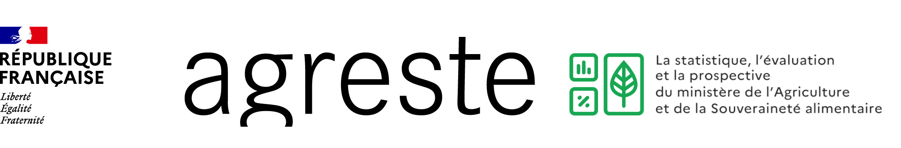

## Liste des formations

Voici la liste prévisionnelle des formations à venir au SSP.\

Ces formations s'adressent aux agents du SSM Agriculture (SSP, SRISE et SISE).

Ce tableau est régulièrement mis à jour par [l'équipe des formateurs R](https://github.com/orgs/SSM-Agriculture/teams/equipe_r).

+------------+---------------------------------------------------+-------------+--------------------------------------------+-------------------------+
| Lieu       | Formation                                         | Durée       | Date(s)                                    | Nombre participants max |
+============+===================================================+=============+============================================+=========================+
| DISTANCIEL | Fondamentaux de la programmation                  | 1 jour      | 8 septembre 2026                           | Pas de limite, en webex |
|            |                                                   |             |                                            |                         |
|            |                                                   |             |                                         |                         |
|            |                                                   |             |                                            |                         |
|            |                                                   |             | En amont des formations R initiation Paris |                         |
+------------+---------------------------------------------------+-------------+--------------------------------------------+-------------------------+
| DISTANCIEL | Prise en main des outils de traitement de données | 1/2 journée | 22 septembre 2026                          | Pas de limite, en webex |
|            |                                                   |             |                                            |                         |
|            |                                                   |             |                                         |                         |
|            |                                                   |             |                                            |                         |
|            |                                                   |             | En amont des formations R initiation Paris |                         |
+------------+---------------------------------------------------+-------------+--------------------------------------------+-------------------------+

 

+------------+-----------------------------------+------------+------------------------+-------------------------+
| Lieu       | Formation                         | Durée      | Date(s)                | Nombre participants max |
+============+===================================+============+========================+=========================+
| PARIS      | 3 modules R perfectionnement :    | 3 jours    | 16, 17 et 18 juin 2026 | 12                      |
|            |                                   |            |                        |                         |
|            | -   Shiny                         |            |                        |                         |
|            |                                   |            |                        |                         |
|            | -   Quarto                        |            |                        |                         |
|            |                                   |            |                        |                         |
|            | -   Git                           |            |                        |                         |
+------------+-----------------------------------+------------+------------------------+-------------------------+
| PARIS      | R initiation                      | 2 jours    | 6 et 7 octobre 2026    | 12                      |
+------------+-----------------------------------+------------+------------------------+-------------------------+

 

+-----------+-----------------------------------+-----------+---------------------+-------------------------+
| Lieu      | Formation                         | Durée     | Date(s)             | Nombre participants max |
+===========+===================================+===========+=====================+=========================+
| AUZEVILLE | Cartographie                      | 1 jour    | À définir sur le T4 | 12                      |
+-----------+-----------------------------------+-----------+---------------------+-------------------------+
| AUZEVILLE | R initiation                      | 2 jours   | 28 et 29 sept. 2026 | 12                      |
+-----------+-----------------------------------+-----------+---------------------+-------------------------+

Module debogage : à tester en formation à distance ou sur le site d'Auzeville.
